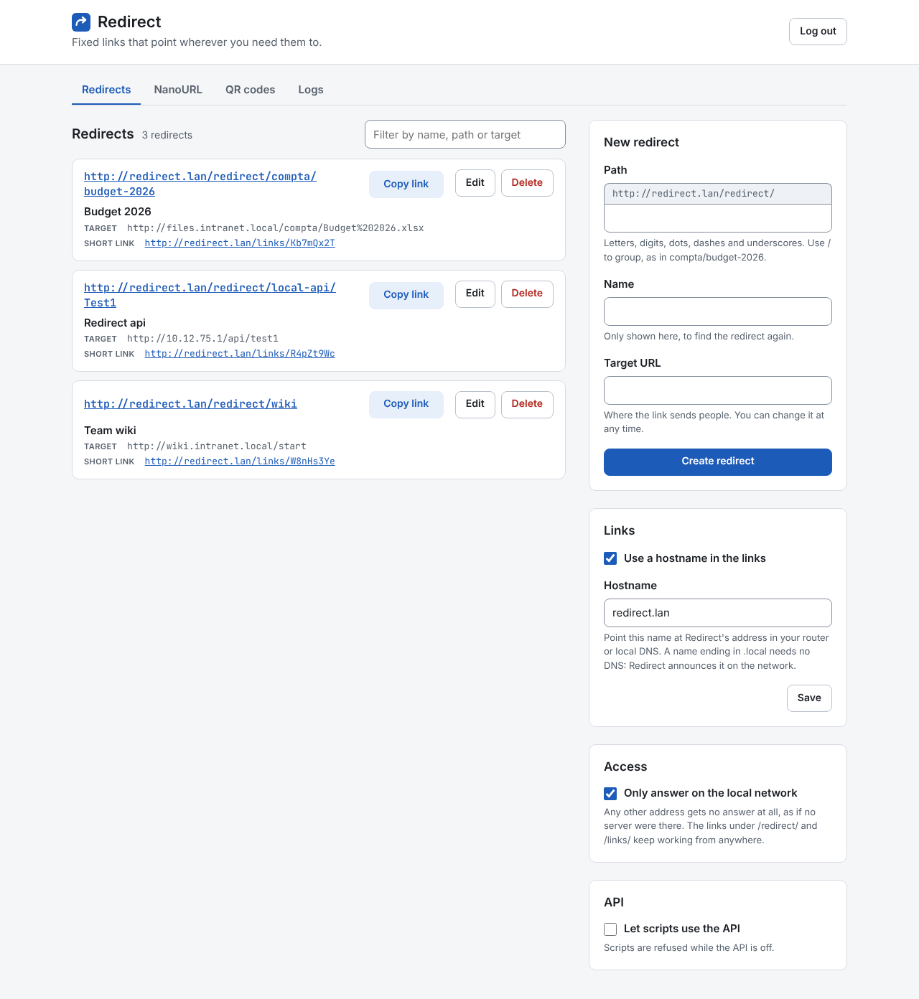

# Redirect

Redirect gives out fixed links and sends each one to a target you can change at any time. Say an Excel file on the local network changes URL from time to time: people receive `http://redirect.lan/redirect/compta/budget-2026` once, and when the file moves you change the target in Redirect instead of sending a new link. A link answers with an HTTP 302 to its current target, and Redirect never serves or proxies the file itself.



## Run it with Docker

The image is `ghcr.io/cestmoiroma/redirect`, for `linux/amd64` and `linux/arm64`. It listens on port 80.

Redirect works best with an address of its own on the LAN: the links are then `http://192.168.1.20/redirect/<path>`, with no port, and nothing else on the Docker host competes for port 80. The `compose.yaml` of this repository gives it one with a macvlan network. That is the setup Redirect is tested with; published ports, the host network and other container runtimes have not been tested.

```yaml
services:
  redirect:
    image: ghcr.io/cestmoiroma/redirect:latest
    restart: unless-stopped
    networks:
      lan:
        ipv4_address: 192.168.1.20
    volumes:
      - redirect-data:/data
    environment:
      ADMIN_PASSWORD: ''

networks:
  lan:
    driver: macvlan
    driver_opts:
      parent: eth0
    ipam:
      config:
        - subnet: 192.168.1.0/24
          gateway: 192.168.1.1

volumes:
  redirect-data:
```

Set `ipv4_address` to a free address outside the range your router's DHCP hands out, `parent` to the host's network interface, and `subnet` and `gateway` to those of your LAN. Put a password of 8 characters or more in `ADMIN_PASSWORD`, then run `docker compose up -d`. With macvlan, the Docker host itself cannot reach the container's address: use Redirect from another machine of the network.

The interface is then at `http://192.168.1.20/`, and the links read `http://redirect.lan/redirect/<path>` (see below for that name). The redirects live in a SQLite file, `redirect.db`, in the `redirect-data` volume, so they survive restarts and upgrades. Each release is also tagged with its version, such as `0.1.0`: pin it to upgrade when you choose.

| Variable              | Default         | What it does                                                                                                   |
| --------------------- | --------------- | -------------------------------------------------------------------------------------------------------------- |
| `ADMIN_PASSWORD`      | unset           | Password of the interface, 8 characters or more. Unset, the interface and the API are open to anyone.          |
| `API_ENABLED`         | unset           | `true` or `false` forces the scripts' API on or off. Unset, the switch in the interface decides, off at first. |
| `LOCAL_ONLY`          | unset           | `true` or `false` forces the local-only access on or off. Unset, the Access card decides, on at first.         |
| `HEADLESS`            | `false`         | `true` turns the interface off: the redirects are managed through the API, with the API key.                   |
| `LOG_RETENTION_DAYS`  | `90`            | Days the log keeps its events.                                                                                 |
| `PORT`                | `80`            | Port the server listens on. Change it only when port 80 of the container's address is taken.                   |
| `DATA_DIR`            | `/data`         | Folder of `redirect.db`. The server runs as uid 10001, which must be able to write there.                      |
| `PUBLIC_BASE_URL`     | unset           | Base of the links, e.g. `https://go.example.org`, over the hostname of the interface. For a reverse proxy.     |
| `LOG_LEVEL`           | `INFO`          | `DEBUG`, `INFO`, `WARNING`, `ERROR` or `CRITICAL`.                                                             |
| `FORWARDED_ALLOW_IPS` | `127.0.0.1,::1` | Addresses whose `X-Forwarded-Proto` and `X-Forwarded-For` headers are trusted.                                 |

### Name the links

The links use a hostname, `redirect.lan` by default: `http://redirect.lan/redirect/<path>`. Point that name at Redirect's address in your router's DNS or your local DNS server. The Links card of the interface changes it, or turns it off: the links then use the address your browser used to reach Redirect.

A name ending in `.local`, such as `redirect.local`, needs no DNS: Redirect announces it on the network with mDNS, and the Links card says so. Most computers and phones resolve such names. The announcement reaches the LAN because the container has its own address on it; behind published ports it does not.

### Behind a reverse proxy

Set `PUBLIC_BASE_URL` to the address people use, for example `https://go.example.org`. Without it, the links in the interface follow the `Host` header the proxy forwards, and they stay `http://` even when the proxy serves HTTPS: Redirect only trusts `X-Forwarded-Proto` from the loopback. Setting `FORWARDED_ALLOW_IPS` to the proxy's address makes it honour that header. When `PUBLIC_BASE_URL` is set, it always wins.

### Set a password

With `ADMIN_PASSWORD`, the interface opens on a login screen. A login lasts 30 days and survives restarts, since its signing secret lives in the volume. Changing the password logs every session out. Five wrong passwords from one address within 15 minutes lock that address out for the rest of the window.

Without it, anyone who can reach the port can create, change or delete redirects, and a web page opened on a machine of the same network can reach the API through DNS rebinding. Every page of the interface says so in red. The links under `/redirect/` are public either way: anyone who has one can follow it.

The password travels as typed. Over plain HTTP, keep Redirect on a network you trust. To reach it from outside, put a reverse proxy serving HTTPS in front of it and publish the container's port to that proxy only.

### Keep the interface on the local network

Redirect's interface and API only answer addresses of the local network: the private IPv4 ranges, loopback, link-local, IPv6 ULA, and `100.64.0.0/10`, which Tailscale and similar VPNs use. Any other address gets a 403, so an interface exposed to the internet by mistake stays closed. The links under `/redirect/` and `/links/` work from anywhere, which is what a printed QR code needs. The Access card turns this off, and `LOCAL_ONLY` forces it either way.

Behind a reverse proxy, Redirect sees the proxy's address, which is local, for every visitor. Set `FORWARDED_ALLOW_IPS` to the proxy's address so that Redirect reads the visitor's real address from `X-Forwarded-For`.

## Create a link and change its target later

Open the interface, fill in the path, a name and the target URL under New redirect, then click Create redirect. Copy link on the new entry puts its full public link in the clipboard, ready to share. When the file moves, click Edit on the entry and change the target URL: the link people already have leads to the new target from their next click.

Each redirect also has a short id of 8 characters and a short link, `http://redirect.lan/links/k3F9xQ2a`, shown under its target. It leads to the same target and stays the same when the path changes.

Paths starting with `Api`, `QRcodes` or `NanoURL` are kept for Redirect's own sections: a redirect typed by hand cannot use them.

## Share a NanoURL or a QR code

A NanoURL is a short link made from a name and a target: the NanoURL section gives `http://192.168.1.20/links/k3F9xQ2a` and files it under `NanoURL/<name>`. Change its target later and the short link stays.

NanoURLs and QR codes write their link with Redirect's IP address by default, the address the interface was reached on: it works even when no DNS entry or mDNS answer reaches the person who opens it. Choose Hostname at creation to write it with the hostname instead, such as `http://redirect.lan/links/k3F9xQ2a`. Both forms lead to the same place; the choice only decides which one is shown and printed.

A QR code works the same way under `QRcodes/<name>`, and the code carries the short link, so a printed QR code follows the target you set afterwards, as long as Redirect keeps its address. The QR codes section chooses its look: the color and shape of the modules and of the corners, a background color or none, a logo in the center, the margin. A preview follows each change, and Download SVG saves the file. Colors too close to the background are refused, since scanners could not read them. A QR code on the hostname carries the hostname of the moment: change the hostname and the QR codes you print afterwards change too.

## Read the log

The Logs section lists every visit of a link with its date, path, code, the visitor's address and browser, every change of a redirect with who made it (the interface or a script), and every read of the API by a script. It keeps the last `LOG_RETENTION_DAYS` days, 90 by default, and drops older events on its own.

## Change redirects from a script

Scripts use an API key rather than the password. The API is off at first: turn it on in the API card of the interface, or force it with `API_ENABLED`. Then generate the key in the same card: it is shown once, so copy it then. Only its hash is stored, in the volume, so it survives restarts. Regenerate it when it leaks: the old key stops working at once. The key needs `ADMIN_PASSWORD` or `HEADLESS`, since without a password the API is open anyway.

Send it as a bearer token:

```sh
KEY=rdk_...
BASE=http://192.168.1.20

# List: every redirect with its id, slug, name, target, public link and short link
curl -H "Authorization: Bearer $KEY" $BASE/api/list

# Create (201): the answer carries the new redirect's id, such as "k3F9xQ2a"
curl -H "Authorization: Bearer $KEY" -H 'Content-Type: application/json' \
  -d '{"slug": "compta/budget-2026", "name": "Budget 2026", "target": "http://files.lan/budget.xlsx"}' \
  $BASE/api/redirects

# Change it (200): send all three fields
curl -X PUT -H "Authorization: Bearer $KEY" -H 'Content-Type: application/json' \
  -d '{"slug": "compta/budget-2026", "name": "Budget 2026", "target": "http://files.lan/budget-v2.xlsx"}' \
  $BASE/api/redirects/k3F9xQ2a

# Delete it (204)
curl -X DELETE -H "Authorization: Bearer $KEY" $BASE/api/redirects/k3F9xQ2a
```

The other routes take the same key:

- `GET /api/logs` returns the log, newest first: `limit` (1 to 1000, 100 by default), `before` (the `next` of the previous page) and `kind` (`visits`, `changes` or `reads`).
- `POST /api/nanourls` with a `name`, a `target` and an optional `link_host` (`ip`, the default, or `hostname`) creates a NanoURL and answers 201 with its `id` and its `short_url`. `GET` lists them, `PUT` and `DELETE /api/nanourls/<id>` change or remove one.
- `POST /api/qrcodes` with a `name`, a `target`, an optional `link_host` and an optional `design` creates a QR code and answers 201 with its `id` and the image itself in `svg`. `GET /api/qrcodes/<id>/svg` serves the file, and `PUT` and `DELETE /api/qrcodes/<id>` change or remove one. A `design` holds `color`, `eye_color` and `background` (`#rrggbb`, or `transparent` for the background), `module_style` (`square`, `rounded` or `dots`), `eye_style` (`square`, `rounded` or `circle`), `logo` (a `data:image/...;base64,` URI), `logo_size` (0.1 to 0.3) and `margin` (0 to 10).

Errors come back as JSON with a `detail` message and, for invalid fields, one message per field in `errors`: 401 for a missing or wrong key, 403 while the API is off or from outside the local network, 404 for an unknown id, 409 for a path or a name already taken, 422 for invalid values. The key only manages redirects: generating a new key takes a login in the interface.

## Run it without the interface

With `HEADLESS=true`, the interface is off: anything but the links and the API answers one line of plain text, `Redirect is running`, and the redirects, NanoURLs, QR codes and the log are only reachable through the API, with the API key. On its first start, a headless Redirect creates a key and writes it once to its log:

```sh
docker compose logs redirect | grep "API key created"
```

To get a new key, which replaces the old one at once, even while Redirect runs:

```sh
docker compose exec redirect python -m redirect api-key
```

## Work on the code

You need `just` and Docker. Lint, tests and screenshots run in a pinned image built from `test/ci/Dockerfile` for `linux/amd64`, emulated on ARM machines, and never on the host. The application image is a separate one, built from the root `Dockerfile`.

- `just run` starts the app on the host with auto-reload, at `http://127.0.0.1:8080`, with its data in `./data`. It needs `uv`.
- `just lint` runs every formatter and linter in check mode. `just fmt` applies the formatters.
- `just test redirect` runs pytest, then the end-to-end scenario in Chromium, which rewrites the screenshots.
- `just ci` runs what CI runs, in the same order, and ends by building and testing the application image. Commit first: the screenshots are compared with `HEAD`.
- `just image` builds the application image as `redirect:local`. `just up` runs it on `http://localhost:8080` and `just down` stops it.

The screenshots in `test/screenshot/redirect/` must match the commit byte for byte. After an intended UI change, run `just redirect-gui-goldens`, look at every image that changed, and commit them with the change. A new screen goes into `test/redirect/screenshots.py`, and `just gui-goldens-stability redirect 3` proves its captures are stable.

## Release an image

Pushing a tag `vX.Y.Z` publishes the image. The version must equal `version` in `pyproject.toml` and `__version__` in `redirect/__init__.py`, or the `publish` job stops before building anything. Bump both, run `uv lock`, commit, then tag that commit:

```sh
git tag v0.1.0
git push origin v0.1.0
```

The workflow in `.github/workflows/ci.yml` first runs the jobs of `just ci`: lint, tests, screenshots and the application image test. When they pass, the `publish` job builds the image for `linux/amd64` and `linux/arm64`, pushes it by digest, and runs the image test again on both platforms against the pushed image. Only then does it tag the image `X.Y.Z` and `latest`, so a failure leaves the existing tags where they were.

Nothing runs until the repository variable `CI_ENABLED` is `true`. The workflow pushes with its own `GITHUB_TOKEN`, granted `packages: write`, and GHCR creates `redirect` as a private package on the first push: make it public in the package settings, or `docker pull` asks for a login.
